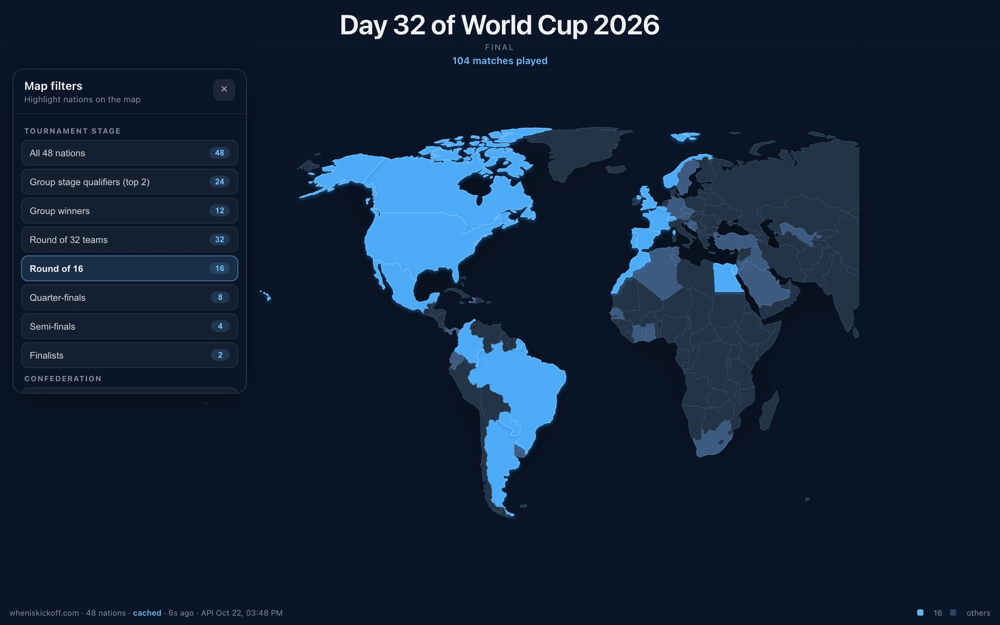
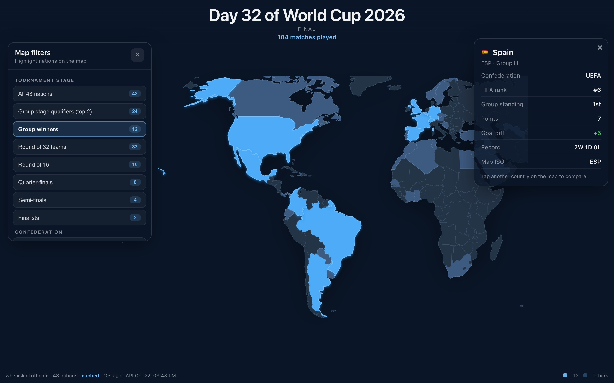

<div align="center">

<h1>WC26</h1>

<p><b>The 2026 World Cup, coloured onto a world map.</b></p>

<p><i>Pick a stage and the map lights up who is still in it. Tap a country for its group record.</i></p>

<h6>


</h6>

<a href="https://wc26.parthchandak.info"><b>Live demo</b></a> ·
<a href="#how-it-works"><b>How it works</b></a> ·
<a href="#features"><b>Features</b></a> ·
<a href="#run-it"><b>Run it</b></a>

<br><br>

<a href="https://wc26.parthchandak.info"></a>

<sub>wc26.parthchandak.info on 22 October 2026, showing the real final results. The data was loaded through the app's local cache; see the note under Run it.</sub>

</div>

<br>

All 48 nations of the 2026 FIFA World Cup on a flat Natural Earth map. Filters highlight one
slice of the tournament at a time, from group qualifiers through to the two finalists, or a
single confederation, and the map zooms to frame whichever nations are lit. Standings are
computed in the browser from the match results published by
[wheniskickoff.com](https://wheniskickoff.com).

## How it works

<table>
<tr>
<td width="33%" valign="top">

**1 · Fetch**

Groups, teams and all 104 matches come from a snapshot of wheniskickoff.com's three JSON files,
served from this site's own `public/data/` and re-read every 60 seconds. The last good copy is
kept in `localStorage`.

</td>
<td width="33%" valign="top">

**2 · Compute**

Group tables are built from finished group matches: 3 points a win, sorted by points, goal
difference, then goals scored. Knockout filters read the bracket from the match list.

</td>
<td width="33%" valign="top">

**3 · Colour**

d3-geo draws the 110m world-atlas countries as SVG paths. Nations in the filter glow blue,
other qualified nations are muted, and d3-zoom handles pan, pinch and auto-framing.

</td>
</tr>
</table>

<div align="center">



<sub>Group winners, with Spain's card open. Real final results.</sub>

</div>

## Features

- **Fourteen filters.** All nations, group qualifiers, group winners, Round of 32, Round of 16,
  quarter-finals, semi-finals and finalists, plus the six confederations, each with a live count.
- **Country cards.** Confederation, FIFA rank, group position, points, goal difference and W-D-L record.
- **Live header.** Tournament day, the current stage, and either the number of matches live now or played so far.
- **Honest freshness stamp.** The footer says whether the data is the `snapshot`, a `cached` copy
  or the built-in `fallback`, and when wheniskickoff.com generated it.
- **Works without the API.** With no network and no cache, the twelve groups are built in, so filters and the map still work.
- **Plain SVG, no WebGL.** This third version replaced a React Three Fiber globe that was slow
  and unreliable on mobile Safari.

## Run it

```bash
git clone https://github.com/parthchandak02/wc26.git
cd wc26
npm install
npm run dev      # builds the ISO lookup, then starts Vite
npm run build    # static site in dist/
```

The build step downloads an ISO 3166 table from GitHub to map world-atlas ids to country
codes, so it needs network access. The output is a static `dist/` folder on Cloudflare Pages.

> **Note.** wheniskickoff.com does not send CORS headers, so a browser can't read its API
> directly. The app instead loads a snapshot saved in `public/data/` (final results, generated
> 24 October 2026). Run `npm run snapshot` to refresh it before a build.

<details>
<summary><b>Project layout</b></summary>

```
src/lib/tournament.ts           API fetch, cache, fallback groups, standings, stage and filter logic
src/components/WorldMapScene.tsx  d3-geo SVG map, d3-zoom, auto-framing and country clicks
src/components/FilterPanel.tsx  Stage and confederation filters
src/data/fifaIso.ts             FIFA code to ISO-3 mapping and filter labels
scripts/build-iso-map.mjs       Generates the numeric ISO lookup at build time
scripts/snapshot-data.mjs       Saves the wheniskickoff.com API snapshot into public/data/
public/_headers                 Cloudflare Pages cache rules
```

</details>

<br>

<div align="center">
<sub>Built with React 19, d3-geo, d3-zoom and world-atlas. Data from wheniskickoff.com.</sub>
</div>
